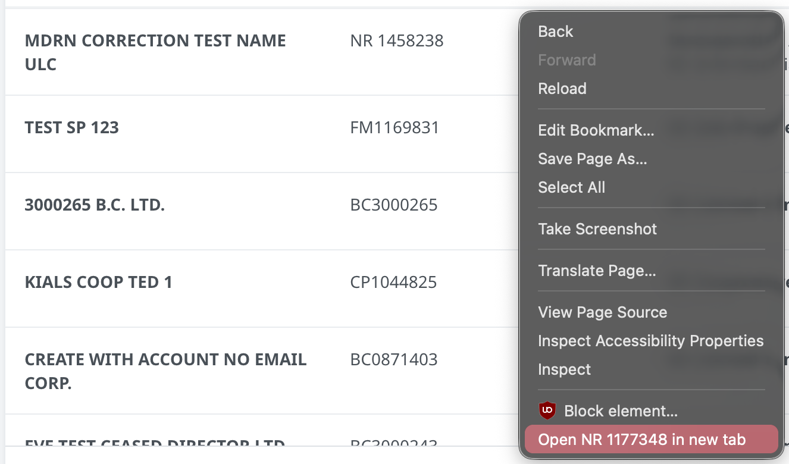

# bcreg-row-actions

A small LibreWolf / Firefox add-on for the BC Registries staff dashboard (My Business Registry). Right click any row in the table and you get a few extra options in the menu, each one opens in a new tab so you don't lose your place in the list.

What shows up depends on the row:

- a business: open its dashboard, open View Access
- a draft (Resume Draft rows): open the draft
- a name request: open the NR, plus Steps to Restore for restoration NRs
- a business that only lives in Corporate Online: open it there (societies go to Societies Online)
- an approved name request: Incorporate Now / Register Now / Amalgamate Now / Continue In Now. Same as pressing the button, it creates the draft and opens it in a new tab. Only works on dev and test.

If an option isn't in the menu it just doesn't apply to that row.

## Install

1. Download `bcreg-row-actions.xpi` from this repo (click the file, then the download button).
2. In LibreWolf go to `about:config`, search `xpinstall.signatures.required` and set it to false.
3. Go to `about:addons` and drag the downloaded file onto the page. Click Add.
4. Reload the dashboard tab.

To update, download the new xpi and drop it on `about:addons` again.

## Something off?

Right click a row that misbehaves, note the business number, and send it over. Dev and test only, nothing here touches prod.
